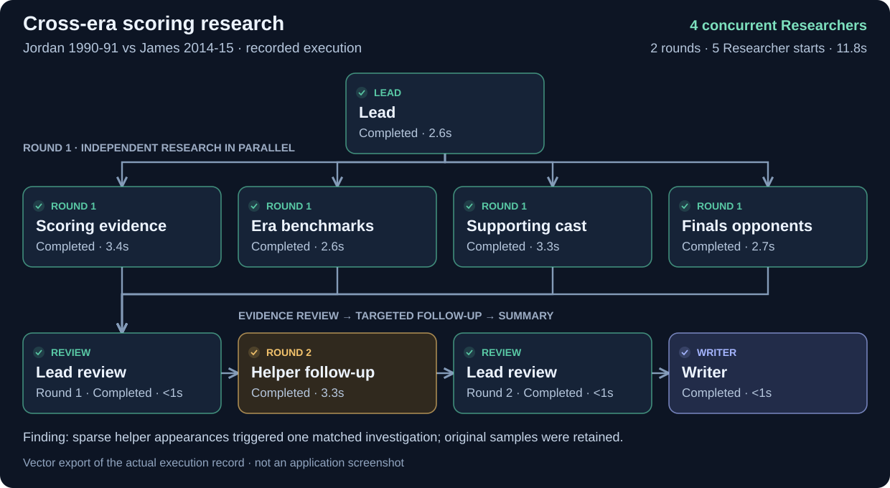

# NBA On-Court Research

A **Deep Research** assistant comparing two NBA players’ observed on-court contributions across eras: **offense, playmaking, defensive evidence and team on/off**, with optional teammate/Finals context. Use careers or equal-length windows from **1984-85**, excluding ongoing seasons.

**Research question:** which player has the stronger supported contribution in the requested dimensions, and does that judgement survive era, phase and team-context checks? Answers start with a position, explain the decisive evidence, and separate a supported advantage from an unresolved overall ranking. Missing historical data never counts as poor performance.

**For:** NBA fans, sports writers and analysts who want source-backed comparisons with explicit time periods and statistical criteria.

## Research and data

**Lead → parallel Researchers → Lead review → Writer.** Lead clarifies vague requests and locks scope; Researchers collect evidence in fresh contexts; discovered gaps can trigger targeted follow-up; Writer reports checked findings. The expandable graph shows actual tasks and tool calls. Runs are capped at three rounds and 240 seconds. Short scoring-ability questions need only a period clarification; the confirmed broad scope retains all four research dimensions. Undefined influence is clarified before choosing observed on-court research or explaining unsupported cultural/commercial scope. [Short-question demonstration](docs/AMBIGUITY-REVIEW.md). [Workflow acceptance](docs/CONTENT-FOLLOWUP.md).



**Recorded run (SVG export, not a UI screenshot):** Jordan 1990-91 vs James 2014-15. Four Researchers investigate scoring, era, teammates and Finals opponents in parallel. Kevin Love appears in only **4 playoff games**, versus **20** for the largest returned rotation sample. This triggers one targeted second-round Researcher, who retrieves matched regular-season context for both players (Love: **75 games**). The conclusion is narrower: the short playoff sample cannot stand for full-season support; the new phase does not replace it or explain absences. No fault injection. [Full prompt and run notes](docs/LONG-PROMPTS.md). Select **Investigate helper samples** on the home screen to try this case; a second round is triggered by an evidence gap, not scheduled for every question.

Data comes from NBA.com through `nba-api`, without an NBA API key. The repository ships a compressed response snapshot in [`data/nba_seed.sqlite3.gz`](data/nba_seed.sqlite3.gz), with provenance and a checksum in [`data/manifest.json`](data/manifest.json). On server startup, a new installation restores it into the writable `data_cache/nba.sqlite3`; an existing cache is preserved. Requests reuse cached responses or fetch additional data through the same tools. Original retrieval dates are retained: expired responses are refreshed when possible, and an unsuccessful refresh uses the saved response with a stale-data warning. Missing uncached data is reported as unavailable. The snapshot is a bounded collection of observed responses, not a complete historical NBA database. [Contents and regeneration](data/README.md). Sources include `playercareerstats` (`SeasonTotalsRegularSeason`, `SeasonTotalsPostSeason`), `leaguegamelog`, `teamplayerdashboard`, historical rosters and Finals/opponent records, plus `teamplayeronoffsummary` for on/off minutes and team ratings. Each example identifies its source endpoints below.

PPG, TS, assists/turnovers and per-36 rates use summed inputs; relative TS uses attempt-weighted same-season, same-phase league differences. Defensive box-score activity is a proxy; team on/off is observational and may be unavailable historically. Long-period on/off is bounded to the first and last two team-season stints, disclosed rather than averaged. Missing/stale evidence is disclosed. Era and team context cannot prove innate ability, injuries or hypothetical championship outcomes. [Formulas, provenance and limits](docs/BENCHMARK.md).

## Run locally

Configure Google Cloud application-default credentials with Vertex AI access. Default model: `vertex_ai/gemini-3.5-flash-lite`, location `global` (`NBA_RESEARCH_MODEL` overrides it).

```bash
uv sync
cd frontend
npm ci
npm run build
cd ..
uv run uvicorn app:app --host 127.0.0.1 --port 8000
```

Open `http://127.0.0.1:8000`, select an example or enter two players and a comparison period. Choose a clarification option or write a reply before research starts; season-window choices include validated year fields. Broad scoring reports state a rate-and-efficiency verdict before the evidence, with split or insufficient findings disclosed. [Interaction and verdict checks](docs/CHOICES-AND-VERDICT.md). Expand the graph and evidence to inspect results.

## Three sample queries and same-model comparison

Expected values are independently recomputed from original NBA responses. Tolerances: points ±1, PPG ±0.2, TS ±0.2 percentage points, including changes. Scope errors and missing answers are separate from numeric errors. The tables summarize the frozen answers linked in full per query.

### 1. Career scoring claim

> Assess the claim that Michael Jordan was a stronger scorer than LeBron James over their entire NBA careers. Compare regular-season and playoff scoring volume and efficiency, efficiency relative to each season's league, and bounded teammate and Finals-opponent context. Use completed seasons through 2025-26. Give a conditional judgement, not an overall-player ranking.

**Expected:** conditional. Jordan leads scoring rate; James leads accumulation and the selected efficiency measures. Regular-season Jordan/James PPG: **30.12/26.78**, TS: **56.86/59.01%**. Playoff PPG: **33.45/28.22**, TS: **56.76/58.34%**. Sources: `playercareerstats` (`SeasonTotalsRegularSeason`, `SeasonTotalsPostSeason`), `leaguegamelog`, `teamplayerdashboard` / `commonteamroster`, `teamyearbyyearstats` and `playergamelog`.

| Check | Raw LLM | Agent |
|---|---|---|
| Completed-season scope | Substitutes completed 2024-25 plus 2025-26 trajectories | Uses requested completed 2025-26 cutoff |
| Regular-season PPG; TS, Jordan/James | 30.1/27.1; 56.9/58.9% under its substituted cutoff | 30.12/26.78; 56.86/59.01% |
| Playoff PPG; TS, Jordan/James | 33.4/28.4; 56.8/58.3% under its substituted cutoff | 33.45/28.22; 56.76/58.34% |

**Difference:** Raw does not respect the requested cutoff, despite mostly close numbers (7/8 within tolerance if scope is ignored); Agent matches all eight values in scope. [Both complete answers](docs/benchmark/2026-11-11-frozen/pairs/career.md).

### 2. Equal scoring windows

> Assess whether Kobe Bryant's scoring in 2005-06 through 2007-08 was stronger than Stephen Curry's scoring in 2014-15 through 2016-17. Compare equal three-season windows, regular-season scoring volume, raw shooting efficiency and contemporaneous league-relative efficiency. Show which metric advantages change with the statistical lens.

**Expected:** Bryant leads volume; Curry leads efficiency. PPG: **31.74/26.36**; TS: **57.08/64.47%**; attempt-weighted relative TS: **+3.19/+10.20 percentage points**. Sources: `playercareerstats.SeasonTotalsRegularSeason` and same-season regular-season `leaguegamelog`.

| Metric, Bryant/Curry | Raw LLM | Agent |
|---|---|---|
| PPG | 31.8/26.4, both within tolerance | 31.74/26.36, both within tolerance |
| TS | 56.3/62.7%, both outside tolerance | 57.08/64.47%, both within tolerance |

**Difference:** both identify the tradeoff; Agent supplies accurate aggregates. Raw's differently weighted relative-TS ranges are not directly scored. [Both complete answers](docs/benchmark/2026-11-11-frozen/pairs/windows.md).

### 3. Postseason changes

> Assess the claim that Michael Jordan had stronger postseason scoring than LeBron James. Compare Jordan's 1990-91 through 1992-93 with James's 2011-12 through 2013-14, using postseason points per game, true shooting and their changes from the corresponding regular seasons. Limit conclusions to these equal three-season samples.

**Expected:** Jordan leads playoff PPG (**33.69/27.89**); James leads playoff TS (**57.21/60.39%**). PPG changes: **+2.34/+0.88**; TS changes: **−1.00/−2.89 percentage points**. Sources: `playercareerstats.SeasonTotalsRegularSeason` and `SeasonTotalsPostSeason` for the matching windows.

| Check, Jordan/James | Raw LLM | Agent |
|---|---|---|
| PPG change | +1.6/+1.6 | +2.34/+0.88 |
| TS change, percentage points | −1.3/+2.3 | −1.00/−2.89 |
| All 12 phase values/changes | 3/12 within tolerance | 12/12 within tolerance |

**Difference:** Raw says James's efficiency rises; the data show a decrease, changing the conclusion. [Both complete answers](docs/benchmark/2026-11-11-frozen/pairs/postseason.md).

## Evaluation scope

The comparisons above use the same exact question and `gemini-3.5-flash-lite`. Raw receives one user message with no system prompt, tools or history; Agent retrieves NBA records and calculates from source totals. The clearest observed difference is the reversed direction of James's postseason efficiency change. The other examples demonstrate scope control and more accurate aggregates.

The frozen six-question batch matches **44/44 required focal-player numbers** for Agent. [Complete reviewed results](docs/benchmark/2026-11-11-frozen/REVIEWED.md) retain Raw-correct cases and Agent defects. This benchmark predates later Writer/UI changes, checks a limited set of facts and does not establish universal accuracy. No same-tools single-agent comparison was run, so it does not isolate the benefit of multiple agents from access to tools. [Protocol and reproduction](docs/BENCHMARK.md).

## Verification

```bash
uv run python -m unittest discover -s test
cd frontend
npm test
npm run build
```

Tests cover scope and identity handling, citations, numerical checks, research flow, session boundaries and loading the shipped dataset. Saved local acceptance evidence includes [parallel and follow-up execution](docs/CONTENT-FOLLOWUP.md), [context and source checks](docs/CONTEXT-REVIEW.md), and [broader on-court comparisons and limitations](docs/IMPACT-UPGRADE.md). Historical reports retain the test counts and revision boundaries observed at the time; they are not deployment certificates.

## Deployment

Deploy the repository root to Cloud Run using continuous deployment from GitHub. Install the locked Python dependencies with `uv sync --frozen`; `frontend/dist` is committed so the Python server can serve the built interface. Keep `data/` in the deployment image: startup restores the bundled snapshot automatically, with no separate GCS download required for this snapshot.

Start the service with:

```bash
uv run uvicorn app:app --host 0.0.0.0 --port "${PORT:-8080}"
```

Configure the runtime service account for Vertex AI, use a request timeout of at least 300 seconds, and keep the service available until grading is complete. Additional or refreshed NBA responses require outbound access to NBA.com. Model generation still requires Vertex AI even when all requested source data is cached. Runtime cache and conversation history are local to each instance and are not durable across Cloud Run restarts.

`submission.json` records the service URL, author `jq2426` and path `research`. Before submitting the GitHub repository URL on Courseworks, verify the deployed revision, all three homepage examples, streamed responses and source links, and grant the specified graders access if the repository is private. The checked-in URL alone does not establish that the current revision is deployed.
