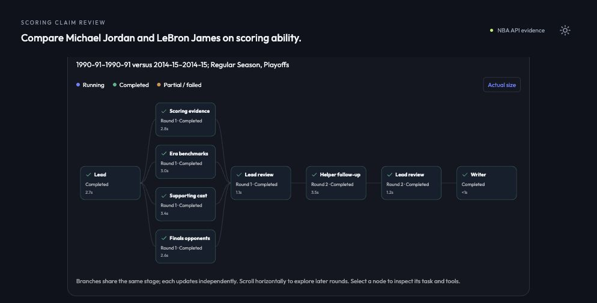

# From a short question to scoped research

Broad scoring requests now retain their scope across clarification replies. Previously, a reply containing only season windows could drop requested teammate/opponent context because dispatch checks inspected only the latest message. Broad scoring ability/performance now includes bounded context even for explicit windows; narrow metric requests and explicit context exclusions still select only the relevant dimensions. A completed report starts a new scope boundary.

## Real-model checks

| Initial question | Clarification supplied by the tester | Observed Agent behavior |
|---|---|---|
| Compare Michael Jordan and LeBron James on scoring ability. | Use Jordan in 1990-91 and James in 2014-15. | Asked career versus equal windows; after the date reply, dispatched personal, era, teammate and Finals-opponent Researchers. |
| Compare Michael Jordan and LeBron James on influence. | I mean observed scoring performance. Use Jordan in 1990-91 and James in 2014-15. | Asked which meaning of influence was intended; after scoring was confirmed, dispatched the same four research dimensions. |

Both cases started no Researchers and collected no statistical evidence before clarification. Both then discovered sparse helper appearances and added one targeted teammate Researcher in round two. No collector failures or extra rounds were injected. All answers, contracts, model metadata, tool calls and evidence are retained: [ability](ambiguity-review/ability.json), [influence](ambiguity-review/influence.json).

This is bounded scoring research, not a new cultural, commercial or causal-impact product. Four initial Researchers are appropriate for these broad requests; more agents are not a quality score. A second round still requires a concrete evidence gap. Recognition uses the contract resolver plus conservative scope checks; two tested phrasings do not establish universal language coverage.

## Honest Raw comparison

Each case also preserves two same-model Raw calls: the initial question alone, and the original question plus the user's clarification. Each call contains one user message, no system prompt, no tools and no Agent outputs. Agent receives its own clarification history, so this is an exploratory conversational comparison, not the original frozen single-turn benchmark or a compute-matched experiment.

Raw answered both broad questions at length; it did not become obviously less fluent or less comprehensive. On undefined influence it chose cultural/business interpretations, which the question did not rule out. That is not, by itself, an incorrect answer. Agent's advantage here is making the intended scope explicit before investigating.

After scope clarification, Raw's ability answer placed James's TS at **50.8%** in its season comparison; source totals give **57.66% regular season** and **48.67% playoffs**. Raw's influence answer gave **57.7% regular season** (close), but approximately **47.7% playoffs**. Both correct and incorrect Raw figures are retained. Eight Agent TS values were independently recomputed from original NBA `resultSets`: [checks and inputs](ambiguity-review/numeric-checks.json), [archived source index](ambiguity-review/sources.json). This does not score every claim or prove general superiority.

## Verification

**372 Python tests pass**, including seven new clarification-scope tests: preserved context after date replies, broad windows, narrow requests, explicit exclusions, scoped history, and repair of incomplete initial plans. [Test log](ambiguity-review/python-tests.txt). Production frontend code is unchanged; the previous 16 frontend tests remain applicable.

A fresh two-turn browser conversation also completed with four concurrent initial Researchers and one evidence-driven follow-up after only the date reply. [Observed interface](ambiguity-review/browser-ax.txt).



Reproduce live calls (uses the configured model and NBA response cache):

```bash
uv run python -m test.live_ambiguity_review --case ability
uv run python -m test.live_ambiguity_review --case influence
```

The three mandatory README queries and frozen paired answers remain unchanged. No deployment or submission was performed.
