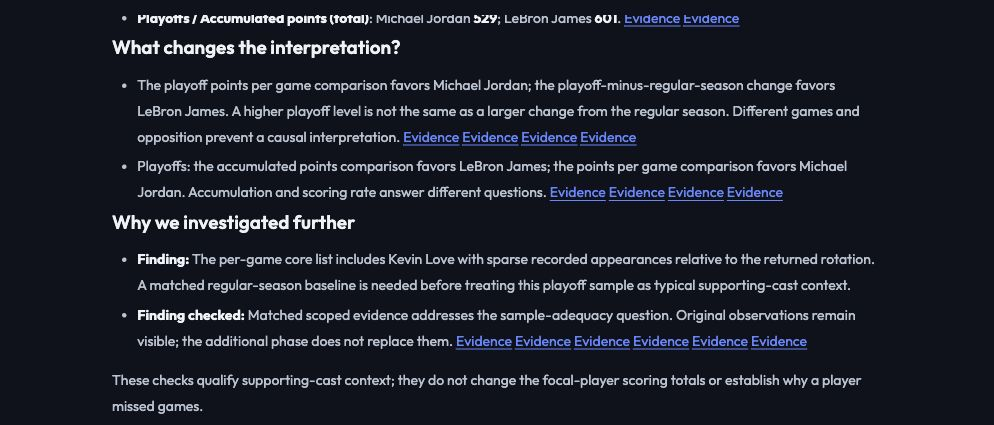

# Answer clarity and evidence-driven follow-up

This revision changes presentation, not the frozen Raw/Agent answers or source calculations. README now leads with the observed postseason conclusion reversal, acknowledges broad agreement on the other examples, and distinguishes tool-backed reliability from unmeasured multi-agent benefits.

Reports put the claim assessment and named metric advantages before key evidence. Volume and efficiency highlights must include their two requested metric families when available, even if Writer selects only one. Postseason highlights retain playoff PPG and TS; phase changes appear before detailed tables. Evidence gaps get a visible **Why we investigated further** section with original and additional citations. Unresolved checks remain explicitly limited.

## Necessary second-round demonstration

Select **Investigate helper samples** on the home screen and send the supplied question. In the fresh run, four first-round Researchers completed successfully. Kevin Love's playoff record contained **4 games**, versus **20** in the largest returned rotation sample. This triggered one additional teammate Researcher, not a repeat of all collectors. Matched regular-season context was retrieved for both subjects; Love's row contained **75 games**. Original playoff rows stayed visible.

The research changes the permitted interpretation: a short playoff appearance sample cannot represent full-season support. It does not change the focal-player scoring totals, establish absence causes, or prove who had better teammates. The screening threshold is a declared heuristic (below half the maximum returned rotation GP), not a general measure of teammate quality. Other complete cases can finish in one round.

The [full fresh run](answer-clarity/support_findings.json) completed in 16.99 seconds with no injected failure. The [postseason run](answer-clarity/postseason.json) completed in 9.37 seconds and retained Jordan/James TS changes of -1.00/-2.89 percentage points. These are warm-cache observations, not latency guarantees or new paired Raw comparisons.

## Verification

- **365 Python tests and 16 frontend tests passed.** Regression checks cover conclusion order, requested highlight coverage, visible follow-up, and honest failed-follow-up wording. [Python log](answer-clarity/python-tests.txt).
- Independent original-table audit passed: **702 helper metrics, 34 Finals metrics and 42 published context values**, with scope, source membership and citations checked. [Results](answer-clarity/context/results.json). This covers returned rows in this case, not every possible question.
- A fresh browser conversation completed in two rounds without clarification. The new explanation remained visible while full tables stayed collapsed. [Observed UI](answer-clarity/browser-ax.txt).
- The first one-off postseason text assertion expected `-1.00`; rendering correctly uses `-1`. The assertion was corrected to the actual formatting; no source value or saved answer was changed.



Replay the independent context audit without model or NBA calls:

```bash
uv run python -m test.context_audit --folder docs/answer-clarity/context
```

No deployment or submission was performed. Earlier acceptance artifacts and the original paired benchmark remain historical records of their respective revisions.
