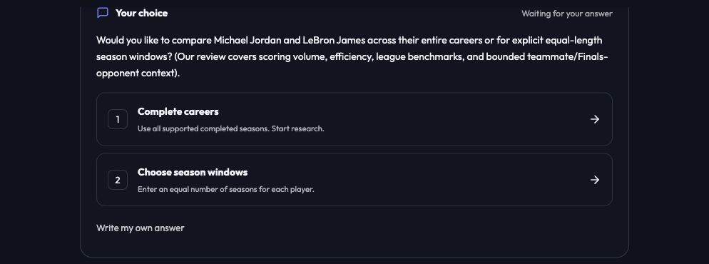
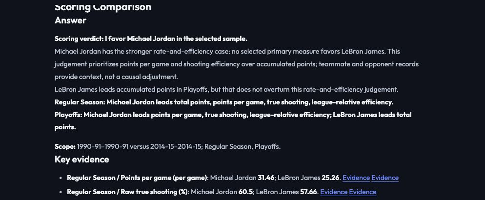

# Clickable clarification and an explicit scoring position

Clarification replies now include a waiting-for-input card. For a missing comparison period, **Complete careers** sends a normal follow-up message; **Choose season windows** opens four start-year fields and checks supported years, ordering and equal window lengths. **Write my own answer** preserves free text. Influence questions use meaning choices; other clarification types use a text field. Historical turns without metadata retain a conservative period-question fallback. Only the latest unanswered turn is actionable, and submission is guarded against duplicate clicks.

The existing `/chat` and streamed response shapes are unchanged. The Lead's `confirm_scoring_contract` tool result adds `clarification_kind` (`period`, `influence` or `custom`). Choices are ordinary user messages, so server scope/identity checks still apply. The form does not bypass research or choose peak years for the user.

## A position with a stated basis

Broad scoring reports now start with a rate-and-efficiency judgement. When a player is not behind on any complete selected primary measure (PPG, TS and league-relative TS when present) across the approved phases, and leads at least one, the report explicitly favors that player. Accumulated points are still reported and opposing accumulation is explained. This is a disclosed comparison rule, not a fitted weighting formula, overall-player ranking, causal context adjustment or free-form unsupported Writer opinion.

For Jordan 1990-91 versus James 2014-15, the fresh report begins **"Scoring verdict: I favor Michael Jordan in the selected sample."** It explains why James's higher accumulated playoff points do not overturn the rate-and-efficiency judgement. Split primary measures, ties or missing evidence do not produce a forced winner. Existing fixed all-metric claim assessments remain separate from this explicitly prioritized judgement; frozen benchmark answers are unchanged.

## Verification

- **375 Python tests and 22 frontend tests passed**; type checking and production build passed. Tests cover selection metadata, legacy fallback, invalid windows, scope-action suppression, a winner despite opposing accumulation, conflicting evidence, ties and missing evidence.
- A fresh browser question produced clickable period choices. Unequal windows displayed an error without submitting. Correcting the end year and clicking **Confirm windows** submitted exactly the intended player/season ranges, disabled the old form and completed two research rounds.
- The resulting UI displayed the explicit Jordan verdict and 66 internally checked numerical claims. This is not a new independent whole-answer accuracy benchmark. [Observed UI](choices-verdict/browser-ax.txt).
- The one-click career path, influence-choice variants and arbitrary wording were not exhaustively live-tested; they share the normal message submission path. No deployment or submission was performed.

The earlier [independent source checks](AMBIGUITY-REVIEW.md) cover the scoring numbers in this same period; this change affects presentation and the disclosed interpretation policy.
