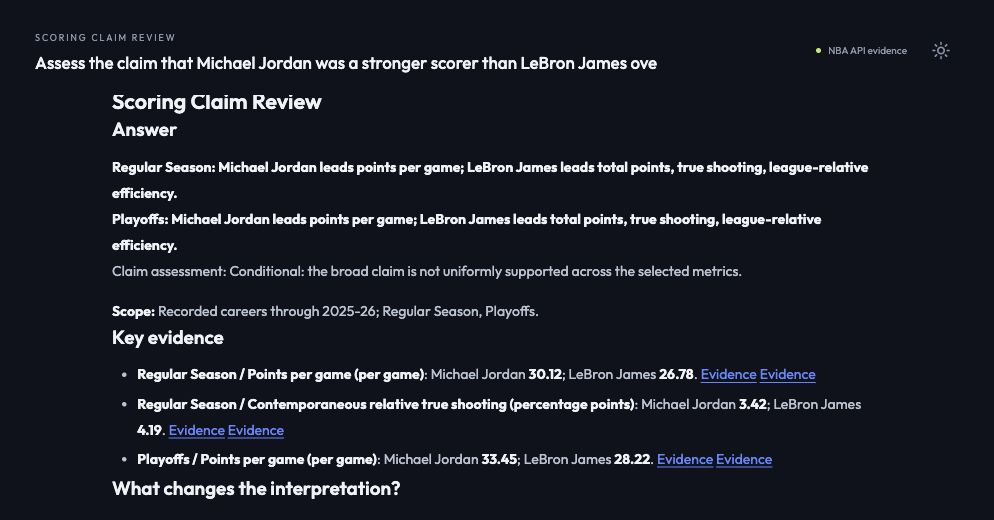

# Cutoff and context acceptance

This revision fixes redundant completed-season clarification and independently audits every returned teammate and Finals record in two fresh real-model runs. It does not rerun or overwrite the historical raw/Agent benchmark.

## Completed-season scope

- Lead receives both equivalent labels: completed 2025-26 and start year 2025. An explicit, valid user cutoff is checked by the server and preserved over an incorrect model default.
- If the model still asks about that validated notation, one bounded internal resolution attempt handles it without another user turn. Missing players, undefined criteria, unequal windows and other real ambiguity remain clarifications.
- Explicit invalid season labels, multiple cutoffs and ongoing/future cutoffs require clarification before model or statistical calls. Unrecognized date wording is left to the resolver; this is not a universal natural-language date parser.
- The original long career question completed directly in fresh command-line runs and the browser, with no confirmation reply. A neutral long comparison and an earlier 2022-23 cutoff also resolved directly. Vague and ongoing-season negative cases still requested clarification. [Actual scope checks](context-review/scope-checks.json).



[Browser answer observation](context-review/browser-career-ax.txt) · [Expanded Finals observation](context-review/browser-finals-ax.txt) · [Ongoing-season rejection in the browser](context-review/browser-ongoing-cutoff-ax.txt).

## Independent background checks

The checker reads original NBA `resultSets`, not normalized production tables, report claims or production aggregation helpers. It verifies every returned context record, including bench records beyond the displayed core/rotation. Original responses and exact parameters are archived for offline replay.

| Fresh case | Helper records / samples | Helper numeric checks | Finals series | Finals numeric checks | Published context numeric checks |
|---|---:|---:|---:|---:|---:|
| Jordan / James, complete careers through 2025-26 | 48 / 4 | 624 | 16 | 272 | 112 |
| Jordan 1990-91 / James 2014-15, including helper follow-up | 54 / 4 | 702 | 2 | 34 | 42 |

There are **1,632 background metric checks**, plus **154 published table-value checks**. Counts are per run and include overlapping observations across the two cases; they are not counts of unique historical facts. The career case contains all 16 verified Finals: ten wins and six defeats across the two subjects. The narrower case repeats two of those series.

Checks cover player/team/season/phase identities; all 13 helper metrics; total minutes; core-helper and top-eight rotation selection; public rotation completeness; earliest/latest anchor selection; all expected Finals including defeats; exact series game IDs; focal-player appearances; series results; all 17 Finals metrics; opponent regular-season record and official win-percentage rounding; displayed values; and exact source-link parameters.

One export defect was found and fixed: reports without a browser session linked only the first source, which could be the focal player's career rather than the helper dashboard or opponent record. Exports now retain every underlying source link. Browser citations continue to open the owning session's complete evidence bundle.

The **62 original responses**, curated context records and results are saved under [context-review](context-review/results.json). The checker imports no production calculation helpers. Mutation tests reject wrong values, missing defeats, wrong game scopes/IDs, wrong helper citations, incorrect selection, altered public rows and omitted source links.

Reproduce without NBA access or the local cache:

```bash
uv run python -m test.context_audit
uv run python -m unittest test.test_scope_cutoff test.test_context_audit
```

To collect a new acceptance batch instead of replaying this archive:

```bash
uv run python -m test.live_scoring_review --case career --output-dir output/context-review
uv run python -m test.live_scoring_review --case support_findings --output-dir output/context-review
uv run python -m test.context_audit --capture output/context-review/career.json output/context-review/support_findings.json
```

## Boundaries

All returned rows in these cases were checked; this is not a claim that every historical roster or arbitrary future report is correct. Historical roster snapshots can omit midseason members. Career helper analysis remains bounded case studies rather than every teammate-season. Games/minutes do not establish shared court time, injuries or causation. Opponent regular-season win percentage is not a complete measure of Finals difficulty. Source snapshots are audit inputs, not an automatic production-data fallback.

The README now places the raw/Agent takeaway table after the three full examples. No deployment or external submission was performed. [Recorded revision and checks](context-review/acceptance.json).
