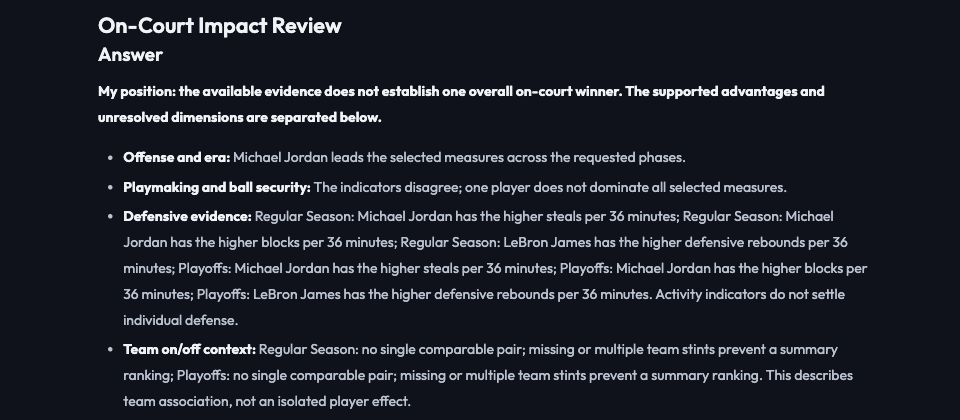

# On-court contribution research

## Scope and implementation

**Question:** Which player's observed on-court contributions are better supported in the requested period, and what changes when era, postseason performance and team context are checked?

| Dimension | Collected evidence | Interpretation boundary |
|---|---|---|
| Offense | PPG, TS, points/36, contemporary league TS | Production and efficiency, not complete offensive value |
| Playmaking | Assists, turnovers, AST/TO, assists/36 | Recorded creation and ball security; no measured gravity or potential assists |
| Defense | Steals, blocks and defensive rebounds/36 | Activity proxies, not complete individual defense |
| Team association | On/off minutes, offensive/defensive/net ratings | Separate team-season/phase rows; not causal player effects |
| Requested context | Core helpers, rotation, Finals opponents | Recorded production and appearances; no injury diagnosis |

Historical box scores form the common layer. Additional on/off evidence is used only where the endpoint returns the exact player/team/phase. Missing historical data is not zero. Long-window on/off samples use the first and last two team-season stints and are explicitly incomplete; ratings are never averaged across stints.

Lead selects relevant dimensions; broad questions fan out in parallel into fresh researcher contexts. Narrow questions need not launch every researcher. Lead reviews actual evidence and can request a second round for sparse helper appearances or rising playoff PPG alongside falling TS. A second review checks completion. Writer selects evidence; a source-bound renderer leads with supported advantages and limits. Highlights pair the same phase, with detailed tables collapsed in the UI.

Limits: 240 seconds, eight researcher starts, four simultaneous workers; no deployment changes. Defensive and overall rankings can remain unresolved rather than manufacture a winner. This is an observed-contribution investigation, not a causal or comprehensive player-impact model.

## Six real paired examples

Exact prompts, both complete answers and model metadata are retained. Raw receives the identical question in **one user message**, with no tools, system prompt, history or subagents. Both paths use `vertex_ai/gemini-3.5-flash-lite`. Cache warmth and model-call counts differ; this is not a compute-matched or single-agent ablation.

| Case | Expected supported result | Full answers |
|---|---|---|
| Jordan 1990-91 / James 2014-15, broad impact | Jordan leads selected scoring measures; playmaking is mixed; missing historical on/off prevents a cross-era team ranking. Two follow-ups inspect helper appearances and scoring opportunity. | [Historical](impact-review/pairs/historical.md) |
| Curry 2015-16 / James 2012-13, modern impact | Curry leads PPG/TS and observed net on/off difference; playmaking indicators disagree. No complete defensive winner. | [Modern](impact-review/pairs/modern.md) |
| Curry / James 2015-16, playmaking | Curry leads assists/36 (7.03/6.83), James AST/TO (2.06/2.01). This is a tradeoff, not a complete creation ranking. | [Playmaking](impact-review/pairs/playmaking.md) |
| Duncan 2002-03 / Garnett 2003-04, defense | Duncan leads blocks/36; Garnett steals and defensive rebounds/36. Endpoint on/off coverage is missing in this run. | [Defense](impact-review/pairs/defense.md) |
| Curry / James 2015-16, team on/off | Net on-minus-off: +23.1/+16.1; this does not establish causal superiority. | [Team](impact-review/pairs/team.md) |
| Jordan 1990-91 / James 2014-15, phase changes | James's PPG rises while TS falls; investigate minutes, attempts and per-minute production before declaring improvement. | [Changes](impact-review/pairs/changes.md) |

## What Raw comparison actually shows

- **Playmaking:** Raw opens with 2016-17 despite the question specifying 2015-16. Agent preserves 2015-16 and distinguishes the assist-rate/ball-security tradeoff.
- **Team on/off:** Raw reports James's minutes as 3,144 and net differential as +8.8. The cited NBA endpoint returns 2,709 on-court minutes and +16.1. Agent exposes the exact source definition, scope, and on/off denominators. Provider differences must be checked before treating any different rating as an error; Raw's unsupported source attribution cannot establish equivalence.
- **Phase changes:** Both paths recognize that higher PPG need not mean improvement. Agent additionally shows the actual follow-up: James's minutes/game 36.13 → 42.20, FGA/game 18.54 → 27.20, points/36 25.17 → 25.64. The evidence narrows the interpretation; it does not prove the reason for the change.
- **Defense:** Both paths acknowledge incomplete defensive measurement. Agent does not replace missing on/off with narrative estimates.

These observations support source traceability and scope control on these cases, not universal superiority. All six cases are retained, including cases where the broad conclusions agree. The established scoring benchmark in the README remains a separate, unchanged historical evaluation.

## Verification and known limits

The six-case implementation batch independently checks **310 contribution values** from original NBA `resultSets`, plus **736 helper/Finals values** in the historical case. This verifies returned records, not all possible team seasons or qualitative basketball claims. Original responses are archived with hashes in [sources.json](impact-review/sources.json); results in [audit.json](impact-review/audit.json).

The [initial batch](impact-review/initial/) includes a mistaken refusal of the team question. The next batch fixes that refusal but still over-expands the team-only scope. [Final targeted reruns](impact-review/final/) verify narrower routing and paired-phase highlights; earlier results are retained rather than overwritten. Three internal researcher-note calls in the six-case batch reached their token limit; metadata records them. Raw answers and the source-bound final report were not truncated. Numerical audit does not certify those intermediate notes.

```bash
uv run python -m unittest discover -s test
cd frontend && npm test && npm run build
cd ..
uv run python -m test.live_impact_review --output-dir output/impact-review-new
uv run python -m test.impact_audit
```

The live script makes real model/API calls. Use a new output directory to preserve previous runs. The audit independently reads cached original responses and archives them; it does not use production aggregation math.

## Final local acceptance

- **392 Python tests; 23 frontend tests; production build passed.**
- Final browser run: five first-round tasks, a four-worker concurrency peak, two evidence-driven follow-ups, Lead follow-up review, and a checked report. The graph now marks each worker finished before its pool slot is reused, avoiding an inflated concurrency count.
- Same-phase paired highlights and expandable detail sections verified through the actual UI. [Browser record](impact-review/browser-ax.txt).
- Final targeted reruns independently rechecked 128 contribution values and 736 helper/Finals values; these overlap the six-case batch and are not extra independent benchmark samples. [Audit](impact-review/final/audit.json).
- Historical coverage gaps and causal limits remain visible. No deployment performed.


