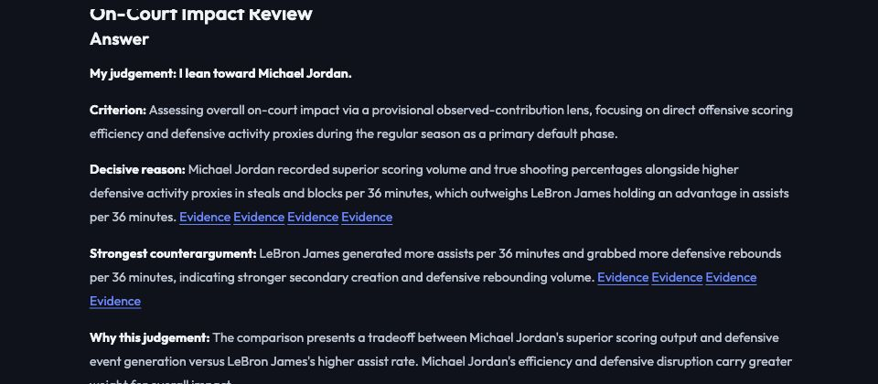

# Question-specific judgements

## Change

The old impact renderer required unanimous metric advantages before preferring a player. Mixed evidence therefore repeatedly produced an unresolved overall verdict. The new Writer can make a **conditional preference**, explain its criterion, address opposing evidence, and say what would reverse the choice. Broad scoring reports use the same judgement/review path; numerical claim adjudication remains separate.

Output order: **choice → criterion → decisive reason → strongest counterargument → tradeoff → reversal condition**. Dimension-by-dimension detail is collapsed in the UI. Key evidence uses the primary phase of the judgement.

A season question defaults to regular-season evidence as primary unless the user explicitly prioritizes postseason performance. The default is disclosed. Helping teammates routes to playmaking/team association; team dependence routes to observed on/off. Neither implies causal attribution. Explicitly on-court questions should not be re-clarified as possible cultural influence.

## Checks and failure behavior

- Deterministic checks require valid, complete supporting comparisons favoring the chosen player and an opposing comparison when one exists.
- A separate model call reviews question relevance, factual scope, tradeoffs and counterevidence; one revision is allowed.
- Per-minute evidence cannot be asserted as per-possession evidence. Unmeasured spacing, gravity and defensive deterrence cannot be asserted as findings.
- Missing evidence is not a tie. Defensive box-score activity alone does not establish a complete defensive winner.
- If prose fails review, the report can offer a **disclosed narrow-criterion fallback** grounded in complete comparisons. It honors explicit supported priorities, otherwise states its limited efficiency/assist-rate/on-off criterion. This fallback is not represented as model-reviewed reasoning or a complete player ranking.
- Reversal conditions are rendered from actual opposing advantages, avoiding a model-generated reversal condition that accidentally strengthens the selected player's case.

The reasoning review is a guardrail, not a correctness guarantee. Interpretations remain conditional and wording can vary. Numerical source verification does not certify subjective basketball judgements.

## Natural-question acceptance

| Short question | Saved behavior |
|---|---|
| Who had more impact on the court: Michael Jordan in 1990-91 or LeBron James in 2014-15? | Prefers Jordan under a disclosed observed-contribution lens; acknowledges James's assist/rebounding advantages. [Run](judgement-review/release/broad.json) |
| Who helped their teammates more in 2015-16, Curry or LeBron? | Conditional Curry preference under the primary regular-season lens; retains opposing postseason evidence. [Run](judgement-review/release/playmaking.json) |
| Who was the better defender: Duncan in 2002-03 or Garnett in 2003-04? | Names proxy advantages but declines a complete defensive ranking because the necessary measurement is missing. [Run](judgement-review/release/defense.json) |
| Whose team depended on him more in 2015-16: Curry or LeBron? | A mistaken meaning clarification was repaired. The final run uses a disclosed on/off fallback after prose review fails, rather than presenting that failure as a tie. [Run](judgement-review/team-fix/team.json) |
| Who was the better scorer: Kobe in 2005-06 or Curry in 2015-16? | Prefers Curry under an efficiency-sensitive criterion, with Bryant's volume advantage as counterevidence. [Run](judgement-review/release/scoring.json) |

The initial outputs and intermediate reruns in `judgement-review/` are retained, including unwanted clarifications, rejected prose, inconsistent phase priorities and a per-possession wording error. These are development checks, not a frozen superiority benchmark. The established Raw LLM benchmark was not rerun or overwritten.

**Final checks:** 405 Python tests, 23 frontend tests, production build and a real browser conversation. Tests cover contradictory support, omitted counterevidence, missing-data ties, unit confusion, unsupported spacing claims, revision exhaustion, primary-phase selection and explicit ball-security priority. The browser visibly presents a qualified Jordan preference with evidence, counterargument and a source-grounded reversal condition. [Browser record](judgement-review/browser-ax.txt).

