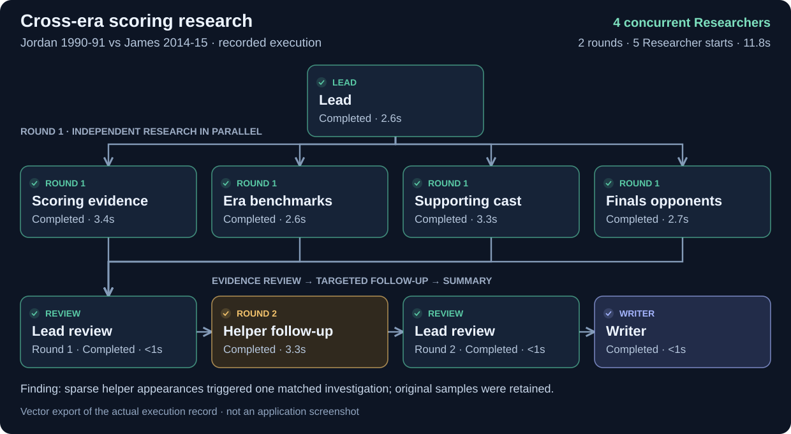

# Long-prompt browser check

Two existing long questions were rerun through the local web interface. This was a documentation/demo check, not a new accuracy benchmark. No collector failures or extra research rounds were injected, and no production code was changed.

## Selected README example

> Assess the claim that Michael Jordan's scoring in 1990-91 was stronger than LeBron James's scoring in 2014-15. Compare regular-season and playoff scoring volume and shooting efficiency relative to the league. Compare teammates: core helpers first, then rotation scoring, minutes and recorded games. Check whether the per-game helper leaders adequately represent the supporting cast's recorded availability. Keep original samples and qualify any limited context.

This run completed in two rounds, with a peak of four concurrent Researchers. All supported research dimensions were exercised: personal scoring, contemporary league benchmarks, supporting cast and Finals opposition. Lead then dispatched one additional helper investigation after the sparse-appearance finding involving Kevin Love. Original observations remained available and Writer completed the report. The production audit checked 66 numeric claims; this is an internal evidence check, not an independent whole-answer accuracy score.

The vector export shows nine execution nodes: Lead, four first-round Researchers, Lead review, one second-round Researcher, another Lead review and Writer. Lead review nodes are repeated work by Lead, not separate additional agents. There are five Researcher starts in total.



[Original UI screenshot](images/multi-agent-research.jpg) · [Observed UI state](images/long-prompt-flow-ax.txt) · [Recorded checks and screenshot hash](long-prompt-checks.json).

## Other long question

> Assess the claim that Michael Jordan was a stronger scorer than LeBron James over their entire NBA careers. Compare regular-season and playoff scoring volume and efficiency, efficiency relative to each season's league, and bounded teammate and Finals-opponent context. Use completed seasons through 2025-26. Give a conditional judgement, not an overall-player ranking.

The initial attempt unnecessarily requested clarification about the already specified completed 2025-26 cutoff. The tester confirmed that this corresponds to season start year 2025 and kept the original players and dimensions. Research then completed in one round, with a conditional assessment separating Jordan's scoring-rate advantage from James's accumulation/efficiency advantage. The production audit checked 136 numeric claims.

This historical case is not represented as an uninterrupted success. No prompt tuning or code fix was made for this screenshot task. The redundant cutoff clarification was subsequently addressed in the [cutoff/context revision](CONTEXT-REVIEW.md), which preserves these original observations and records a fresh direct-completion browser check. [Initial UI observation](images/long-prompt-career-ax.txt) · [Conversation after confirmation](images/long-prompt-career-resumed-ax.txt).

The three mandatory README sample queries and their prior same-model paired answers remain unchanged. The screenshot illustrates a real completed workflow; it is not a guarantee that every query uses all Researcher roles or requires a second round.

## Vector export

The README uses a self-contained SVG generated from the same saved execution record. It contains vector paths and text, without a sidebar, composer, embedded screenshot or external fonts. Its compact arrangement differs from the application layout; node identities, dependency edges, statuses and timings are preserved. The original UI screenshot remains available as evidence above.

[Recorded execution data](images/multi-agent-research.flow.json) · [Raster preview of the SVG](images/multi-agent-research-vector-preview.jpg).

Reproduce the SVG from the repository root:

```bash
python scripts/export_demo_flow_svg.py docs/images/multi-agent-research.flow.json docs/images/multi-agent-research.svg
```
