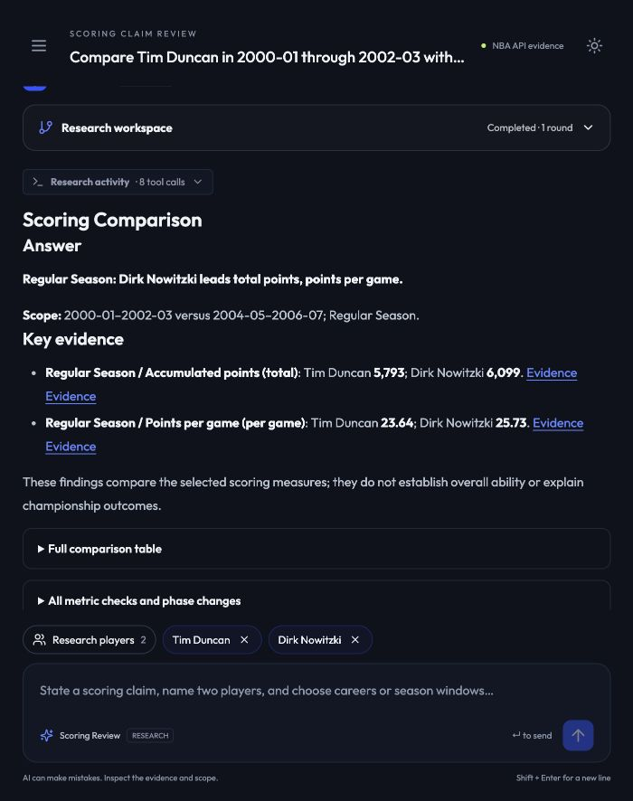

# Writer and browser acceptance

The interface was exercised through the in-app browser at http://127.0.0.1:8767/. This is development acceptance of a new revision, not a rerun of the historical frozen raw/Agent benchmark. Existing paired answers and source snapshots were preserved.

## Findings from the interface

1. A neutral Duncan/Nowitzki question with explicit three-season windows was incorrectly rejected as unequal. After a user clarification, the old Lead additionally demanded identical calendar years. Those are different requirements. [Original UI observation](images/writer-review/baseline-ax.txt).
2. The old report opened with a generic conditional/contradicted label, followed by the comparison contract. Specific advantages and actual values appeared later among many sections.
3. Writer only chose highlight indices; fixed rendering controlled most of the prose and section order. A longer Writer prompt alone could not solve the information hierarchy.
4. An intermediate postseason run still selected regular-season accumulated points as a headline despite the question asking about playoff PPG, TS and changes. That selection was removed during this review.

## Changes

- Lead distinguishes a user-supplied directional claim from a neutral comparison. Neutral reports name the metric advantages, use a comparison result type and do not invent a premise to contradict. Existing claim assessments remain available.
- False unequal-window clarifications are corrected only when full player names and explicit user-supplied season ranges match the candidate contract, the inclusive lengths agree, and the complete review contract validates. The last user-supplied dated request can be reused after a scope clarification; assistant-invented dates are never used. Truly unequal, ambiguous or changed ranges still require clarification.
- The answer now comes first, naming the favored player for each phase/metric family. Two or three cited numerical highlights follow immediately. Postseason highlights prioritize playoff PPG and TS; regular-season totals cannot displace them.
- Requested postseason changes appear in the main qualification section, including values and the player with the larger change. A higher playoff level is distinguished from a larger change; negative changes are not described as improvements.
- Full tables, all sensitivity checks, supporting-cast/Finals evidence, coverage and methods are expandable. Original Markdown remains complete for copying, storage and API consumers. Legacy history is not reformatted, and arbitrary HTML remains escaped.
- The live graph stays visible during research and automatically folds after completion unless the user is actively inspecting it. Important counterevidence and unresolved coverage warnings remain outside the folded details.
- Numeric output still passes the existing scoped evidence audit. No free-form model statistics bypass the renderer.

## Browser cases

| Case | Observed result |
|---|---|
| Duncan 2000-01–2002-03 vs Nowitzki 2004-05–2006-07, volume only | The new run completes instead of demanding identical years. Its first answer names Nowitzki as leading total points and PPG, followed by 5,793/6,099 points and 23.64/25.73 PPG. No shooting-efficiency row enters the main answer. |
| Durant 2011-12–2013-14 vs Harden 2016-17–2018-19, efficiency only | The first answer names Durant as leading both efficiency measures. Highlights show 63.15/61.62 TS and 9.67/6.00 relative-TS percentage points. No volume highlights appear. |
| Wade 2005-06 vs Leonard 2018-19, whole-postseason levels and changes | The answer names Leonard for playoff PPG/TS. The main qualification separates TS change favoring Wade from the PPG-change advantage favoring Leonard. The full comparison and underlying changes remain available. |
| Jordan 1990-91 vs James 2014-15 with supporting-cast adequacy | The claim assessment remains conditional, with specific regular-season/playoff advantages stated first. Four initial Researchers and a targeted round-two helper investigation remain intact. The main answer retains the Kevin Love sparse-sample qualification; detailed original/follow-up samples remain expandable. Its production audit reports 66 numeric claims checked. |

These are qualitative browser acceptance cases, not independent whole-answer gold labels. The original source value spot check opened Wade's actual authenticated evidence record and confirmed the 2005-06 Playoffs/per-game scope, 654 points in 23 games, 28.4348 PPG and 59.3466 TS, with original inputs/formulas and source parameters. Full-table expansion and the source URL were checked in the browser. [Evidence observation](images/writer-review/evidence-ax.txt).

[Postseason answer screenshot](images/writer-review/postseason-answer.png) · [Explicit change values](images/writer-review/postseason-changes.png) · [Recorded checks and file hashes](writer-ui-checks.json).

## Automated checks

- **336 Python tests passed**, including answer-focus, neutral-comparison, claim-assessment, essential-highlight and false-window-clarification coverage.
- **15 frontend tests passed**, including visible/folded sections, legacy-history compatibility, nested headings and fence handling.
- Frontend type checking and production build passed. The existing large-bundle advisory remains.
- The local service was restarted for the new renderer. No deployment or external submission was performed.

## Limits

Intent resolution still uses an LLM. The unequal-window guard is conservative and supports explicitly named, fully written season windows; it is not a general natural-language date parser. Unrecognized ambiguity must remain a clarification rather than a guessed scope. The result does not demonstrate arbitrary new research dimensions or comprehensive contextual accuracy. The earlier 44/44 focal-value benchmark is historical and is not relabeled as evidence for this entire new revision.

The subsequent [cutoff/context revision](CONTEXT-REVIEW.md) addresses the completed-season clarification defect and adds independent checks of every returned teammate/Finals row in two fresh cases. This earlier Writer acceptance remains a historical record.
